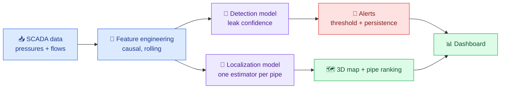

[README.md](https://github.com/user-attachments/files/34855714/README.md)
<div align="center">

# 💧 Where Is The Leak?

### Machine-learning leak **detection** and **localization** for water distribution networks

Built on the **BattLeDIM 2018** benchmark · **L-Town** network · interactive **Streamlit** dashboard

<br>


<br>

[✨ Features](#-features) · [🗂️ Structure](#️-repository-structure) · [🚀 Quick start](#-quick-start) · [📊 Data](#-data-format) · [🧠 How it works](#-how-it-works) · [🛠️ Troubleshooting](#️-troubleshooting)

</div>

---

<!-- Add a screenshot of the dashboard here:    -->

## 🎯 What it does

The app loads SCADA pressure and flow data, runs two trained models, and answers three questions:

| | Question | Answer |
| :-: | --- | --- |
| 🔎 | **Is there a leak?** | A leak confidence for every 5-minute step, turned into alerts. |
| 📍 | **Which pipe is it?** | One confidence per monitored pipe, ranked from most to least suspected. |
| 🗺️ | **Where is it?** | The suspected pipes drawn as stems on a 3D map of the real L-Town network. |

---

## ✨ Features

| View | What you get |
| --- | --- |
| 🗺️ **Map** | 3D network map. Each stem is a monitored pipe; height and colour show leak confidence at the chosen time. Status, alert count and most suspected pipe float on top, and a time slider moves through the analysed period. |
| 📈 **Timeline** | Leak confidence over time against the detection threshold and the documented leak periods, plus **MCC** and **F1** scores when ground truth is available. |
| 🧭 **Pipes** | Pipes ranked by mean confidence and time above threshold, with a heatmap of confidence per pipe over time. |
| 📡 **Sensors** | Raw readings for any selected sensors over the analysed period. |
| 🧠 **Model** | Model details, most important detection features, and a CSV download of all predictions. |
| ⚙️ **Settings** | Data upload, thresholds, alert persistence, network file and analysis period (top-right button). |

---

## 🗂️ Repository structure

```text
Where-Is-The-Leak/
├── 📁 Dataset/                          # BattLeDIM 2018 data
│   ├── 2018_Leakages.csv                #   ground-truth leak flows
│   ├── 2018_SCADA_Flows.csv             #   flow sensors
│   ├── 2018_SCADA_Pressures.csv         #   pressure sensors
│   ├── dataset_configuration.yaml       #   dataset configuration
│   ├── L-TOWN.inp                       #   EPANET network model
│   └── README.txt                       #   original dataset notes
│
├── 📁 Notebooks/
│   └── Where_Is_The_Leak_fixed.ipynb    # data prep, training and evaluation
│
├── 📁 artifacts/                        # outputs of the notebook
│   ├── final_summary.csv                #   summary of final results
│   ├── localization_test_results.csv    #   localization results on the test set
│   ├── prepared_data.joblib             #   prepared data
│   └── water_leakage_models.joblib      #   trained detection + localization models
│
├── 📁 Water_Leakage_App/                # the Streamlit dashboard
│   ├── app.py
│   ├── requirements.txt
│   ├── L-TOWN.inp
│   └── water_leakage_models.joblib
│
└── 📄 README.md
```

> [!NOTE]
> The app looks for the models, the `Dataset` folder and `L-TOWN.inp` next to `app.py` first, then in the repository root. Anything missing can also be uploaded from **⚙️ Settings**.

---

## 🚀 Quick start

**Requirements:** Python 3.9 or newer.

```bash
# 1. clone the repository
git clone https://github.com/<your-username>/Where-Is-The-Leak.git
cd Where-Is-The-Leak/Water_Leakage_App

# 2. install the dependencies
pip install -r requirements.txt

# 3. run the dashboard
streamlit run app.py
```

The app opens at **http://localhost:8501** 🎉

> [!IMPORTANT]
> `scikit-learn` is pinned to **1.6.1** because the models were trained with exactly that version. Other versions can fail to load them or give wrong results.

### 🔁 Re-training the models

Open `Notebooks/Where_Is_The_Leak_fixed.ipynb`, run all cells, and it writes the files in `artifacts/`. Copy the new `water_leakage_models.joblib` into `Water_Leakage_App/` to use it in the dashboard.

### 🎨 Theme

On first run `app.py` creates `.streamlit/config.toml` in the folder you ran the command from. Streamlit only reads the theme at startup, so **stop the app (`Ctrl+C`) and start it once more** to apply the colours. On Windows the `.streamlit` folder is hidden: enable *View → Show → Hidden items* in File Explorer.

---

## 📊 Data format

| File | Content |
| --- | --- |
| 🔵 `2018_SCADA_Pressures.csv` | `Timestamp` and the pressure sensors `n1 … n769`. |
| 🟢 `2018_SCADA_Flows.csv` | `Timestamp` and the flow sensors, including `p227`, `p235` and `PUMP_1`. |
| 🔴 `2018_Leakages.csv` | Optional. Per-pipe leak flow, used as ground truth for the metrics. |

- CSV files use `;` as separator and `,` as decimal mark (a comma-separated file with a dot decimal is also accepted).
- Both the **pressure and flow** files are required. The app lists exactly which sensor columns are missing.
- The models expect a **5-minute** sampling interval; other intervals trigger a warning.
- At least **200 rows** (about 17 hours) are needed to build the rolling features.
- Small gaps in sensor values are interpolated automatically.

### 🧩 Network layout

| If you have… | The map shows… |
| --- | --- |
| `L-TOWN.inp` | the **real** network from its coordinates |
| a coordinates CSV (`id,x,y`) | your own layout |
| neither | a **schematic** layout, clearly labelled as not geographic |

---

## 🧠 How it works



1. 🧮 **Feature engineering.** The app rebuilds exactly the features the models were trained on (differences, rolling means and standard deviations, deviation from a rolling baseline). All are causal, so no future data is used.
2. 🔎 **Detection.** A classifier outputs a leak confidence for every time step. A step becomes an **alert** when the confidence stays above the detection threshold for the chosen number of consecutive steps.
3. 📍 **Localization.** One estimator per monitored pipe outputs the confidence that this pipe is leaking. This drives the map and the pipe ranking.
4. ♾️ **Chronic leak.** Pipe `p257` has a long-lasting leak documented from 8 January 2018 that was never repaired. It is shown separately on the map and excluded from the ranking and from the ground truth used for scoring, so it does not hide the other pipes.

> [!WARNING]
> Scores are model confidence values (tree-ensemble votes), **not calibrated probabilities**. The models were trained on one year and one set of events, so scores show recognition of known leak patterns, not guaranteed generalisation to other networks.

---

## ⚙️ Settings reference

| Setting | Default | Meaning |
| --- | :-: | --- |
| 🎚️ Detection threshold | `0.50` | Confidence above which a time step counts as a leak. |
| 🎚️ Localization threshold | `0.50` | Confidence above which a pipe is highlighted. |
| ⏱️ Alert persistence | `6` steps (30 min) | Consecutive steps above the threshold needed to raise an alert. |
| 📅 Analysis period | last 14 days | Part of the data that is analysed and shown. |

---

## 🛠️ Troubleshooting

| 🐞 Problem | ✅ Fix |
| --- | --- |
| *Models file not found* | Run the notebook, then place `water_leakage_models.joblib` next to `app.py` (or in `artifacts/`). |
| *Open Settings and upload…* message | Upload the pressure and flow CSVs, or make sure the `Dataset` folder sits next to `Water_Leakage_App`. |
| `streamlit` command not found | Use `python -m streamlit run app.py`. |
| Colours did not change | Stop the app with `Ctrl+C` and start it again. |
| Model loading error | Check that `scikit-learn==1.6.1` is installed. |

---

<div align="center">

### 🎓 Graduation project

Built on the **BattLeDIM 2018** (*Battle of the Leakage Detection and Isolation Methods*) benchmark and the **L-Town** network.

💧 *Find the leak before it finds the budget.*

</div>
