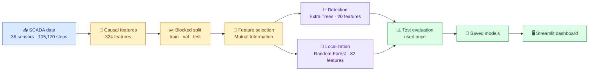

[README.md](https://github.com/user-attachments/files/34857436/README.md)
<div align="center">

# 💧 Where Is The Leak?

### Machine-learning **leak detection** and **leak localization** for water distribution networks

Graduation project · **BattLeDIM 2018** benchmark · **L-Town** network · interactive **Streamlit** dashboard

<br>


<br>

[🎯 Overview](#-overview) · [🗂️ Structure](#️-repository-structure) · [📦 Dataset](#-dataset) · [🧪 Methodology](#-methodology) · [📊 Results](#-results) · [⚠️ Limitations](#️-limitations) · [🖥️ Dashboard](#️-the-dashboard) · [🚀 Quick start](#-quick-start)

<br>

### 🌐 [**Live demo →**](https://YOUR-APP-NAME.streamlit.app) &nbsp;·&nbsp; 📓 [Notebook](Notebooks/Where_Is_The_Leak_fixed.ipynb)

</div>

---

## 🎯 Overview

Water utilities lose a large share of their water to leaks. This project uses the sensors a utility already has (pressure and flow measurements from a SCADA system) to answer two questions automatically:

| | Task | Type | Output |
| :-: | --- | --- | --- |
| 🔎 | **Leak detection** | Binary classification | Is a leak active in the network right now? (`1` = leak, `0` = normal) |
| 📍 | **Leak localization** | Multi-label classification | Which of the 14 monitored pipes are leaking? (one output per pipe) |

Everything is built on **BattLeDIM 2018**, the *Battle of the Leakage Detection and Isolation Methods* benchmark, which simulates one year of a real-world-style network called **L-Town**.

The work has three parts:

1. 📓 **A notebook** that explores the data, builds the targets and features, trains and compares models, and saves the best ones.
2. 🤖 **Two trained tree-ensemble models** (one for detection, one for localization).
3. 🖥️ **A Streamlit dashboard** that loads those models, runs them on SCADA data, and shows the result on a 3D map of the network.

---

## 🗂️ Repository structure

```text
Where-Is-The-Leak/
├── 📁 Dataset/                          # BattLeDIM 2018 data
│   ├── 2018_Leakages.csv                #   ground-truth leak flow per pipe
│   ├── 2018_SCADA_Flows.csv             #   flow sensors
│   ├── 2018_SCADA_Pressures.csv         #   pressure sensors
│   ├── dataset_configuration.yaml       #   dataset configuration
│   ├── L-TOWN.inp                       #   EPANET model of the network
│   └── README.txt                       #   original dataset notes
│
├── 📁 Notebooks/
│   └── Where_Is_The_Leak_fixed.ipynb    # exploration, preprocessing, modeling, evaluation
│
├── 📁 artifacts/                        # written by the notebook
│   ├── prepared_data.joblib             #   train/val/test features + labels + selected features + config
│   ├── water_leakage_models.joblib      #   selected models + feature lists + pipe names + config
│   ├── final_summary.csv                #   final test results (detection and localization)
│   └── localization_test_results.csv    #   per-pipe test results
│
├── 📁 Water_Leakage_App/                # the Streamlit dashboard
│   ├── app.py
│   ├── requirements.txt
│   ├── L-TOWN.inp
│   └── water_leakage_models.joblib
│
└── 📄 README.md
```

---

## 📦 Dataset

| Property | Value |
| --- | --- |
| Period | Full year **2018**, one row every **5 minutes** |
| Rows | **105,120** (identical timestamps in all three files, no missing values, no duplicates) |
| Sensors | **36**: 33 pressure sensors (`n1`, `n4`, `n31`, … `n769`), 2 flow sensors (`p227`, `p235`) and the pump flow (`PUMP_1`) |
| Leak labels | Leak flow in m³/h for **14 pipes** |
| File format | `;` as separator and `,` as decimal mark |

Data source: the BattLeDIM benchmark (see `Dataset/README.txt` for the official source and how to cite it).

Leak behaviour differs a lot between pipes. Some leak for the whole year, others have one short event; some start abruptly, others grow slowly.

<details>
<summary><b>🔍 Behaviour of each of the 14 pipes (from the exploratory analysis)</b></summary>

<br>

| Pipe | Type | Level (m³/h) | Notes |
| --- | --- | :-: | --- |
| `p31` | 🌱 Incipient | ~16 | One event, ends abruptly. |
| `p158` | ⚡ Abrupt | ~24.5 | One event of about 5,000 steps. |
| `p183` | ⚡ Abrupt | ~16.3 | One event of about 7,000 steps. |
| `p232` | 🌱 Incipient (short ramp) | ~26 | Short event, about 3% of the year. |
| `p257` | 🌱 Incipient | ~6.7 | **Long-lasting, never repaired.** Active from 8 Jan 2018 to the end of the year. |
| `p369` | ⚡ Abrupt | ~20 | Short event late in the year. |
| `p427` | 🌱 Incipient | ~5 | Slow growth, never repaired. |
| `p461` | 🌱 Incipient | ~30 | Grows in the first quarter, then drops abruptly (repaired). |
| `p538` | ⚡ Abrupt | ~32.5 | Short, intense burst. |
| `p628` | 🚀 Fast-growing | ~35 | Highest level in the dataset; overlaps `p538`. |
| `p654` | 🌱 Incipient | ~5.4 | Starts late, never repaired. |
| `p673` | ⚡ Abrupt | ~28.4 | Constant for about 18 days (5 to 23 March). |
| `p810` | 🌱 Incipient | ~6.8 | Starts late in the year, never repaired. |
| `p866` | ⚡ Abrupt | ~20.4 | Short event, about 3% of the year. |

</details>

---

## 🧪 Methodology



### 1️⃣ Targets

| Target | Definition |
| --- | --- |
| 📍 **Localization** (multi-label) | One binary column per pipe: `1` when the pipe's leak flow is above **0.05 m³/h**. The small threshold ignores the 0.01 to 0.05 values that appear during the ramp-up of incipient leaks. |
| 🔎 **Detection** (binary) | `1` when at least one pipe **other than `p257`** is leaking, otherwise `0` (normal). |

> [!IMPORTANT]
> **Why `p257` is left out of the detection target.** `p257` is active in every observation where any pipe leaks, so a plain "any leak" target is exactly the `p257` label (97.8% positives, only the first 8 days as normal). That target is almost trivial. Detection is therefore defined as *a leak other than the long-lasting `p257` leak is active*. Localization still includes `p257`.

### 2️⃣ Causal features

Every feature uses only the current and past observations, never future ones. For each of the 36 sensors:

| Feature | Meaning |
| --- | --- |
| raw value | the original measurement |
| `_diff` | change from the previous step |
| `_mean{w}` / `_std{w}` | rolling mean and standard deviation over **15 min, 1 h and 6 h** |
| `_dev144` | deviation of the current value from its **12-hour** rolling mean (removes slow demand patterns) |

This gives **324 features** per time step.

### 3️⃣ Blocked, time-aware split

> [!NOTE]
> A random split would put near-identical neighbouring rows in both train and test, so scores would mostly measure memorisation. A plain chronological split fails too: all normal data sits at the start of the year, so validation and test would contain none.

- The year is cut into **blocks of 5 days**, and whole blocks go to train (70%), validation (15%) or test (15%).
- The block assignment was searched over 2,000 random seeds (selected seed: **243**) so that every split has normal data and as many pipes as possible have enough leak examples.
- A **12-hour gap** is removed on both sides of every boundary between different splits, and the first 12 hours of the year are dropped, so no rolling window reaches across splits.

Together the gaps and the warm-up remove **10,224** rows (105,120 → 94,896 kept).

| Split | Rows | Normal rows | Leak rows | Normal % |
| --- | ---: | ---: | ---: | ---: |
| 🟦 Train | 68,976 | 2,304 | 66,672 | 3.34% |
| 🟨 Validation | 12,960 | 2,592 | 10,368 | 20.00% |
| 🟥 Test | 12,960 | 1,152 | 11,808 | 8.89% |

### 4️⃣ Feature selection (training data only)

**Mutual Information** is computed on a random subsample of 10,000 *training* rows, so validation and test data cannot influence the choice.

- 🔎 **Detection:** the top **20** features.
- 📍 **Localization:** the top **10** features for each pipe, combined into **82** features.

Tree models do not care about feature scale, so no scaling step is used.

### 5️⃣ Models and selection

Two tree ensembles were trained for each task, with class weights to handle the imbalance and moderate hyper-parameters to limit over-fitting to single events:

| Setting | Random Forest | Extra Trees |
| --- | --- | --- |
| Trees | 100 | 200 |
| Class weight | `balanced_subsample` | `balanced` |
| Max depth / min leaf size | 15 / 5 | 15 / 5 |
| Localization wrapper | `MultiOutputClassifier` (one forest per pipe) | `MultiOutputClassifier` (one forest per pipe) |

The model for each task was chosen **on the validation split only**:

| Task | Selection metric | Random Forest | Extra Trees | Selected |
| --- | --- | :-: | :-: | :-: |
| 🔎 Detection | MCC | 0.724 | **0.800** | 🏆 **Extra Trees** |
| 📍 Localization | Macro F1 | **0.896** | 0.891 | 🏆 **Random Forest** |

The **test split was used once**, only for the two selected models. Because *normal* is the rare and important class in detection, it is treated as the positive class for the main detection metrics, together with balanced accuracy and MCC. Plain accuracy is not used for model selection.

---

## 📊 Results

### 🔎 Leak detection: Extra Trees (test set)

| Class | Precision | Recall | F1 |
| --- | :-: | :-: | :-: |
| 🟢 **Leak** (positive class) | 0.954 | 0.996 | **0.975** |
| 🟠 **Normal** (positive class) | 0.930 | 0.508 | **0.657** |

| Balanced accuracy | MCC | ROC-AUC | PR-AUC (normal) |
| :-: | :-: | :-: | :-: |
| 0.752 | 0.668 | 0.947 | 0.753 |

The model almost never misses a leak (recall 99.6%), but it labels about half of the normal test rows as leak. See [Limitations](#️-limitations) for why.

**Sanity check against a time-only baseline.** Normal data all comes from the start of the year, so a model could score well just by learning *when* it is. A tiny decision tree that only sees the position of each row in time was trained as a baseline. On the validation split:

| Model | Balanced accuracy | MCC | ROC-AUC |
| --- | :-: | :-: | :-: |
| ⏱️ Time-only baseline | 0.750 | 0.667 | 0.750 |
| 🌲 Random Forest | 0.827 | 0.724 | 0.967 |
| 🌳 Extra Trees | **0.916** | **0.800** | **0.978** |

Both sensor-based models beat the baseline on validation. The baseline was not scored on the test split.

### 📍 Leak localization: Random Forest (test set)

| Macro F1 | Macro precision | Macro recall | Micro F1 | Weighted F1 | Exact match | Hamming loss |
| :-: | :-: | :-: | :-: | :-: | :-: | :-: |
| **0.906** | 0.885 | 0.932 | **0.937** | 0.938 | 0.717 | 0.034 |

Macro scores average only the pipes that have positive examples in the test set. *Exact match* counts a time step as correct only when **all 14** pipes are predicted correctly.

<details open>
<summary><b>📋 Per-pipe test results</b></summary>

<br>

🟢 F1 ≥ 0.90 · 🟡 0.80 to 0.90 · 🔴 below 0.80 · ⚪ no positive test examples

| Pipe | Precision | Recall | F1 | Support |
| --- | :-: | :-: | :-: | ---: |
| 🟡 `p31` | 0.768 | 0.887 | 0.824 | 1,152 |
| 🟢 `p158` | 0.996 | 0.917 | 0.955 | 1,152 |
| 🟢 `p183` | 1.000 | 0.980 | 0.990 | 2,592 |
| ⚪ `p232` | – | – | – | 0 |
| 🟢 `p257` | 0.921 | 1.000 | 0.959 | 11,929 |
| 🟢 `p369` | 0.868 | 0.951 | 0.908 | 1,152 |
| 🟢 `p427` | 0.954 | 0.997 | 0.975 | 11,808 |
| 🟢 `p461` | 0.842 | 0.979 | 0.905 | 1,152 |
| 🟢 `p538` | 0.831 | 0.995 | 0.906 | 617 |
| 🔴 `p628` | 0.562 | 0.547 | 0.554 | 1,152 |
| 🟢 `p654` | 0.888 | 0.943 | 0.914 | 7,200 |
| 🟢 `p673` | 0.978 | 1.000 | 0.989 | 270 |
| 🟢 `p810` | 0.893 | 0.960 | 0.925 | 6,048 |
| 🟢 `p866` | 1.000 | 0.955 | 0.977 | 1,152 |

</details>

Most pipes are localized well. **`p628`** is the weakest (F1 0.554); its leak overlaps in time with `p538`, which makes the two hard to tell apart.

---

## ⚠️ Limitations

> [!WARNING]
> Read the scores with these points in mind.

- **One normal period.** Only **6.8%** of the year is normal, and it is a single block at the start (1 to 25 January, before the first leak other than `p257` begins). Detection therefore sees little variety in normal conditions, which is why normal recall on the test set is only 0.508.
- **One event per pipe.** Each pipe has essentially one leak event, so localization is tested on *other times of the same events*, not on leaks it has never seen. The scores show how well the sensor patterns identify known leaks; they do not prove generalisation to new ones.
- **Pipes with few examples.** `p232` has no positive rows in validation or test, and `p866` has none in validation. Their scores are unreliable.
- **Not probabilities.** Outputs are tree-ensemble votes, not calibrated probabilities.
- **One network, one year.** The models were trained on L-Town 2018 and are not meant to transfer to other networks without retraining.

---

## 🖥️ The dashboard

The app in `Water_Leakage_App/` loads the saved models, rebuilds the same causal features from raw SCADA data, and shows the result.

| View | What you get |
| --- | --- |
| 🗺️ **Map** | 3D map of the real network. Each stem is a monitored pipe; height and colour show leak confidence at the chosen time. Status, alert count and most suspected pipe float on top, and a time slider moves through the period. |
| 📈 **Timeline** | Leak confidence over time against the detection threshold and the documented leaks, plus MCC and F1 when ground truth is available. |
| 🧭 **Pipes** | Pipes ranked by mean confidence and time above threshold, with a heatmap over time. |
| 📡 **Sensors** | Raw readings for any selected sensors. |
| 🧠 **Model** | Model details, top detection features, and a CSV download of all predictions. |
| ⚙️ **Settings** (top-right popover) | Data upload, thresholds, alert persistence, network file and analysis period. |

### 📖 How to read it

- A time step becomes an **alert** when the detection confidence stays above the threshold for the chosen number of consecutive steps (default: 6 steps = 30 minutes).
- `p257` is shown separately as a **chronic leak** and left out of the pipe ranking and of the ground truth used for scoring, so it does not hide the other pipes. This matches how the detection target was defined.
- Because normal data is only the first weeks of 2018, **later periods of the year will almost always look like a leak**. That reflects the data, not a fault in the app.

---

## 🚀 Quick start

**Requirements:** Python 3.9 or newer.

### ▶️ Run the dashboard

```bash
git clone https://github.com/<your-username>/Where-Is-The-Leak.git
cd Where-Is-The-Leak/Water_Leakage_App

pip install -r requirements.txt
streamlit run app.py
```

The app opens at **http://localhost:8501** 🎉

The app looks for the models, the `Dataset` folder and `L-TOWN.inp` next to `app.py` first, then one level up. Anything missing can be uploaded from **⚙️ Settings**.

> [!IMPORTANT]
> `scikit-learn` is pinned to **1.6.1** because the models were trained with exactly that version. Other versions can fail to load them or give wrong results.

### 🔁 Reproduce the training

```bash
pip install jupyter matplotlib seaborn scikit-learn==1.6.1 pandas numpy joblib
cd Where-Is-The-Leak/Notebooks
jupyter notebook Where_Is_The_Leak_fixed.ipynb
```

Run the cells from top to bottom. The notebook finds `Dataset/` in its parent folder and writes everything to `artifacts/`. Copy the new `water_leakage_models.joblib` into `Water_Leakage_App/` to use it in the dashboard.

### 🎨 Theme

On first run `app.py` creates `.streamlit/config.toml` in the folder you ran the command from. Streamlit only reads the theme at startup, so **stop the app (`Ctrl+C`) and start it once more** to apply the colours. On Windows the `.streamlit` folder is hidden: enable *View → Show → Hidden items* in File Explorer.

---

## 📥 Data the app accepts

| File | Content |
| --- | --- |
| 🔵 `2018_SCADA_Pressures.csv` | `Timestamp` and the pressure sensors. |
| 🟢 `2018_SCADA_Flows.csv` | `Timestamp` and the flow sensors, including `p227`, `p235` and `PUMP_1`. |
| 🔴 `2018_Leakages.csv` | Optional. Used as ground truth for the metrics. |

- Both the **pressure and flow** files are required; the app lists any missing sensor columns.
- The models expect a **5-minute** interval (other intervals trigger a warning) and at least **200 rows** (about 17 hours) to build the rolling features.
- Small gaps in sensor values are interpolated automatically.
- For the map, the app uses `L-TOWN.inp` (real coordinates) if present, then an uploaded `id,x,y` CSV, and otherwise a clearly labelled **schematic** layout.

### ⚙️ Settings

| Setting | Default | Meaning |
| --- | :-: | --- |
| 🎚️ Detection threshold | `0.50` | Confidence above which a step counts as a leak. |
| 🎚️ Localization threshold | `0.50` | Confidence above which a pipe is highlighted. |
| ⏱️ Alert persistence | `6` steps | Consecutive steps above the threshold needed for an alert. |
| 📅 Analysis period | last 14 days | Part of the data that is analysed and shown. |

---

## 🛠️ Troubleshooting

| 🐞 Problem | ✅ Fix |
| --- | --- |
| *Models file not found* | Run the notebook, then place `water_leakage_models.joblib` next to `app.py`. |
| *Open Settings and upload…* message | Upload the pressure and flow CSVs, or keep the `Dataset` folder next to `Water_Leakage_App`. |
| `streamlit` command not found | Use `python -m streamlit run app.py`. |
| Colours did not change | Stop the app with `Ctrl+C` and start it again. |
| Model loading error | Check that `scikit-learn==1.6.1` is installed. |

---

<div align="center">

### 🎓 Graduation project

Built on the **BattLeDIM 2018** (*Battle of the Leakage Detection and Isolation Methods*) benchmark and the **L-Town** network.

💧 *Find the leak before it finds the budget.*

</div>
